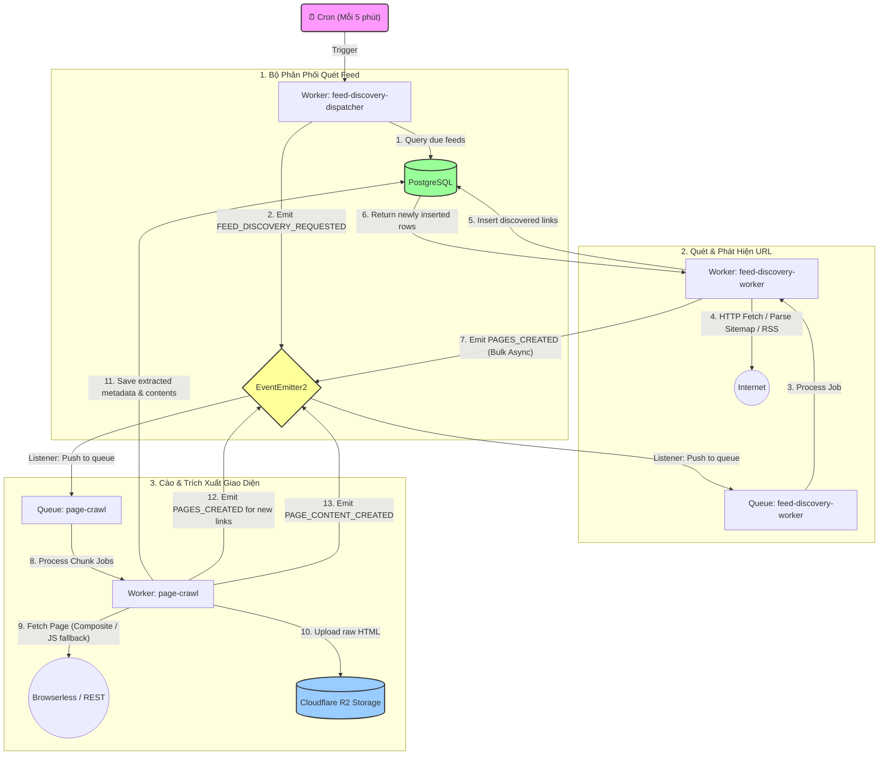

# Kiến Trúc Phát Hiện và Xử Lý URL (URL Discovery & Crawling Architecture)

Tài liệu này mô tả luồng dữ liệu (data flow) và luồng sự kiện (event-driven flow) của hệ thống sau khi chuyển đổi từ Inngest sang **BullMQ + EventEmitter2**.

---

## 1. Luồng Tổng Quan (High-Level Event & Data Flow)

Dưới đây là sơ đồ luồng đi của dữ liệu từ lúc quét nguồn cấp dữ liệu (Feeds/Sitemaps) cho đến khi nội dung bài viết được cào và lưu trữ thành công.

---

## 2. Chi Tiết Từng Luồng Nghiệp Vụ (Detailed Sequence)

### Luồng A: Phân phối Feed (Feed Dispatching)

1. Cứ mỗi 5 phút, BullMQ kích hoạt một repeatable job trên queue `feed-discovery-dispatcher`.
2. Worker truy vấn DB lấy ra danh sách tối đa 100 nguồn feeds (Sitemap, RSS, Atom, JSON Feed) cần được cập nhật.
3. Với mỗi feed cần quét, Worker phát sự kiện `FEED_DISCOVERY_REQUESTED`.
4. Event Listener đón nhận sự kiện này và đẩy một job vào queue `feed-discovery-worker` với `jobId` chính là `feedId` (đảm bảo tính duy nhất, không quét trùng một feed cùng lúc).

### Luồng B: Quét Feed & Trích xuất danh sách liên kết (Feed Scanning)

1. Worker `feed-discovery-worker` lấy job từ hàng đợi, chuyển trạng thái feed trong DB sang `scanning`.
2. Tải và phân tích nội dung feed (Sitemap/RSS). Trích xuất ra danh sách các bài viết bên trong.
3. Thực hiện lưu danh sách bài viết xuống DB bằng hàm `insertBulk` sử dụng cơ chế `onConflictDoNothing()`. Mệnh đề này đảm bảo Postgres chỉ chèn các URL chưa từng tồn tại và chỉ trả về danh sách các bài viết thực sự mới chèn.
4. Phát sự kiện `PAGES_CREATED` kèm theo danh sách các bài viết mới chèn.
5. Event Listener nhận mảng trang web này, **chia nhỏ (chunk) mỗi đợt 1,000 trang** và sử dụng `pageCrawlQueue.addBulk` để nạp vào hàng đợi cào bài viết. Việc sử dụng `await emitAsync` đảm bảo cơ chế **backpressure** (đợi nạp xong chunk trước vào Redis mới chạy tiếp), tránh nghẽn RAM/OOM.
6. Cập nhật trạng thái feed trong DB sang `scanned` và ghi nhận thời gian quét mới nhất.

### Luồng C: Cào chi tiết và xử lý bài viết (Page Crawling)

1. Worker `page-crawl` lấy thông tin URL từ hàng đợi.
2. Cập nhật trạng thái trang sang `crawling`.
3. Cào trang web bằng bộ cào phức hợp (`CompositeCrawlerAdapter`):
   - Đầu tiên cào bằng HTTP Fetch thông thường để tối ưu chi phí.
   - Nếu phát hiện trang web cần chạy JavaScript để render giao diện, hệ thống sẽ tự động chuyển hướng cào sang dịch vụ trình duyệt ảo **Browserless** bằng phương thức REST POST `/content`.
4. Trích xuất văn bản sạch, tiêu đề, mô tả, ảnh thumbnail, tác giả, và các liên kết phụ (outbound links) có trong trang.
5. Đẩy tệp HTML thô lên **Cloudflare R2** dưới dạng nén định danh mã SHA-256 để chống trùng lặp dữ liệu lưu trữ (deduplication).
6. Lưu nội dung văn bản và siêu dữ liệu (metadata) vào bảng `page_contents` và `page_metadata`.
7. Cập nhật trạng thái trang trong DB sang `crawled`.
8. Nếu trang chứa các liên kết phụ mới phát hiện, hệ thống lặp lại bước phát sự kiện `PAGES_CREATED` cho danh sách liên kết mới này để tiếp tục cào sâu hơn. Vòng lặp này sẽ tự động dừng lại khi không phát hiện thêm liên kết mới nào (được kiểm soát chặt chẽ ở bước chèn DB chống trùng lặp).
